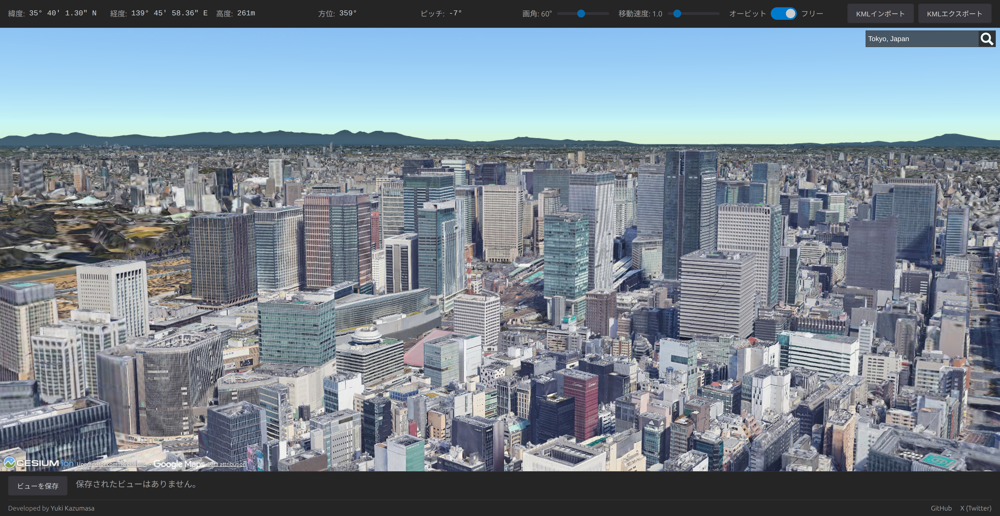
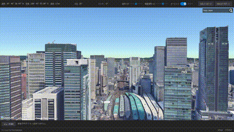
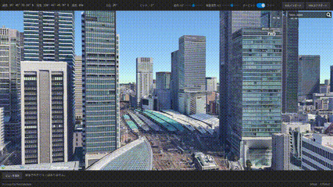
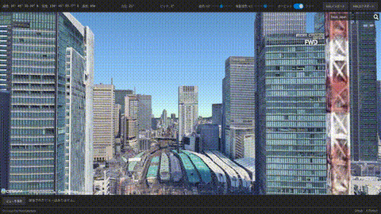
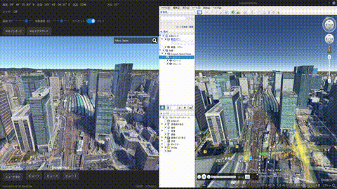

# Earth Viewer

[](https://opensource.org/licenses/MIT)

ドローンのような自由な視点操作で、3D 空間のビューの検討・記録するツールです。



## このツールについて

Google Earth のカメラ操作は、ある地点を周回する「オービット」が中心です。
そのため、真横へのスライドや、上昇下降といった、ドローンのような自由なカメラワークは直感的ではありませんでした。

Earth Viewer の「フリーモード」では、**パン／ドリー（水平・垂直移動）操作**を行いやすくしています。

キーボードで意のままに視点を動かし、気に入ったアングルを「ビュー」として保存。
ビュー同士を瞬時に切り替えながら比較し、最終的には KML で書き出して Google Earth インポートすることもできます。

建築・不動産の眺望確認や、映像制作でのアングル探求など、より緻密な視点操作が求められるシーンで役立ちます。

## 主な機能

- 🚀 **自由なカメラワーク:** キーボードによる直感的な垂直・水平移動。
  - フリーモードでは、ドローンのようにスムーズに空間を移動できます。
  - 
- 📷 **ビューの保存と比較:** 気に入ったアングルを名前を付けて保存し、ワンクリックで切り替え。
  - 保存したビュー（視点）間を瞬時に移動し、アングルを比較検討できます。
  - 
- 🔍 **画角の調整:** シーンに合わせて画角を調整し、より広い視野やズームアップした視点を確認。
  - 
- ⇄ **KML 連携:** 保存したビューリストを KML でエクスポート。KML ファイルのインポートにも対応。
  - Earth Viewer で保存した視点を KML ファイルとして書き出し、Google Earth で同じシーンを再現できます。
  - 
- 🛰️ **カメラ情報:** 緯度経度、海抜高度、カメラの向きなどをリアルタイム表示。

## 使い方

1.  **探す:** マウスとキーボードで、好きなアングルを決めます。
2.  **保存する:** 「現在のビューを保存」ボタンで、名前を付けてビューを記録します。
3.  **切り替える:** 保存したビューリストをクリックすれば、その視点に移動します。
4.  **連携する:** 「KML エクスポート/インポート」で、Google Earth など他のツールと視点を共有できます。

### 操作方法

UI から操作モードを選択できます。

#### オービットモード

地点を中心として周回する、Cesium の標準的な操作モードです。

- **前進/後退:** マウスホイールを回転
- **回転:** `Ctrl` キーを押しながらマウスを左クリック＆ドラッグ

#### フリーモード

ドローンのように空間を自由に移動できる操作モードです。

- **前進/後退:** `W` / `S` キー
- **左/右へ移動:** `A` / `D` キー
- **上昇/下降:** `Q` / `E` キー

---

## 開発者向け情報

### 技術スタック

- React
- Cesium.js
- egm96-universal

### セットアップ

1.  **Cesium Ion アクセストークンの取得**

    - [Cesium Ion](https://cesium.com/ion/) でアカウント（無料プランで OK）を作成し、アクセストークンをコピーします。

2.  **.env ファイルの作成**

    - プロジェクトのルートに `.env` ファイルを作成し、以下を記述します。

    ```.env
    VITE_CESIUM_ION_ACCESS_TOKEN="ここにあなたのアクセストークンを記述"
    ```

3.  **インストールと実行**

    ```bash
    # このリポジトリをクローン
    git clone https://github.com/wasei/earth_viewer.git
    cd earth_viewer

    # 依存関係をインストール
    npm install

    # アプリケーションを実行
    npm start
    ```

    ブラウザで `http://localhost:3000` を開きます。

## 免責事項

本ソフトウェアは MIT ライセンスのもとで公開されています。  
いかなる保証も行いませんので、自己責任にてご利用ください。

## ライセンス

[MIT](LICENSE)
